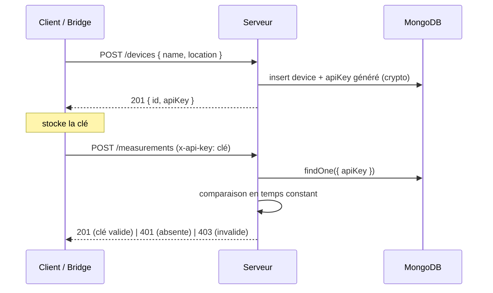
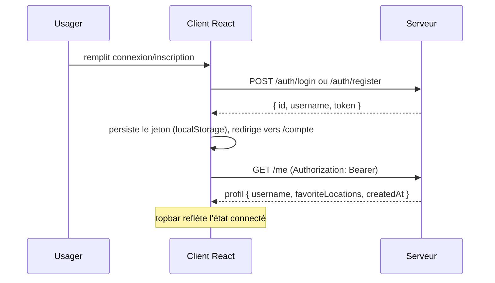

# Rapport — Infrastructure de collecte d'ambiance

**IFT3225 — Livrable 1, Phase 1**
**Équipe :** Rayyan Oumlil, Aness Lakhdar Azzouz
**Université de Montréal — Été 2026**

---

> **Pour les correcteurs, accès base de données**
>
> L'URI de connexion MongoDB (utilisateur `correcteur`, lecture/écriture) est fournie dans la remise Studium. Placez-la dans `MONGO_URI` (`.env` à la racine) avant de lancer `npm start` ; vous pouvez alors tester le bridge et les endpoints POST. Les données de collecte sont déjà présentes : aucun import n'est nécessaire (`npm run import:phyphox`/`import:obs` servent uniquement à une nouvelle collecte et ajoutent des documents plutôt que d'en supprimer).

---

Ce rapport constitue la spécification du protocole de communication avec notre système. Il décrit les ressources exposées, les conventions adoptées, le mécanisme d'authentification, la chaîne de collecte, la logique d'agrégation des endpoints sémantiques, ainsi que les limites assumées.

---

## 1. Ressources et endpoints

### 1.1 Table complète des endpoints

| Méthode | Chemin | Auth | Corps attendu | Réponse (succès) | Codes possibles |
|---------|--------|------|---------------|------------------|-----------------|
| `POST` | `/devices` | Non | `{ name, location }` | `201` + `{ id, apiKey }` | 201, 400, 500 |
| `GET` | `/devices` | Non | — | `200` + `[ { id, name, location, createdAt } ]` | 200, 500 |
| `POST` | `/measurements` | `x-api-key` | `{ type, value, location, timestamp? }` | `201` + document créé | 201, 400, 401, 403, 500 |
| `POST` | `/observations` | `x-api-key` | `{ location, proximity, vibe, notes?, timestamp? }` | `201` + document créé | 201, 400, 401, 403, 500 |
| `GET` | `/ambiance/:location/snapshot` | Non | — | `200` + portrait courant | 200, 404, 500 |
| `GET` | `/ambiance/:location/history?last=3h` | Non | — | `200` + séries temporelles | 200, 404, 500 |
| `GET` | `/ambiance/:location/quiet-hours` | Non | — | `200` + heures calmes | 200, 404, 500 |

### 1.2 Justification du découpage en ressources

Nous avons identifié quatre entités du domaine et tranché lesquelles deviennent des ressources REST :

- **`devices`** — un appareil collecteur (téléphone). Devient une ressource : il a un cycle de vie propre (enregistrement, identité, clé) et doit être créé/listé.
- **`measurements`** — une mesure sonore brute horodatée. Ressource : c'est l'unité atomique persistée, créée massivement par la collecte.
- **`observations`** — une saisie environnementale (proximité, vibe). Ressource distincte des mesures car de nature différente (qualitative, manuelle, basse fréquence) et avec un schéma propre. Les regrouper avec `measurements` aurait imposé un schéma polymorphe fragile.
- **`ambiance`** — **n'est pas une entité persistée** mais une *vue dérivée*. Nous l'exposons comme ressource de lecture car elle répond à la question métier « quelle est l'ambiance de ce lieu ? », mais elle ne possède ni `POST` ni stockage : elle agrège `measurements` + `observations` à la volée.

**Alternatives envisagées.** Nous avions considéré une ressource unique `/data` polymorphe (type = audio | observation). Rejetée : validation ambiguë, filtrage plus complexe, et couplage de deux flux aux fréquences très différentes. Le découpage actuel garde chaque ressource cohérente et validable indépendamment.

**Gestion des lieux.** Choix retenu : **création implicite**. Un `location` est une simple chaîne portée par chaque mesure/observation ; il n'existe pas d'endpoint `POST /locations`. Justification : un lieu n'a pas d'attributs propres au-delà de son identifiant dans cette phase, et la création implicite simplifie la collecte (le bridge n'a pas à pré-déclarer le lieu). Compromis : pas de validation d'existence d'un lieu (une faute de frappe crée un « nouveau » lieu) — limite assumée, voir §6.

---

## 2. Conventions

| Convention | Choix | Intention / problème résolu |
|------------|-------|------------------------------|
| Nommage des ressources | Noms au **pluriel**, en minuscules (`/measurements`, `/devices`) | Prévisibilité : une collection se lit au pluriel ; `/ambiance` au singulier signale qu'il s'agit d'une vue, pas d'une collection. |
| Horodatage | **ISO 8601** (`2026-06-12T14:00:00.000-04:00`) | Format non ambigu, fuseau explicite, trié lexicographiquement = trié chronologiquement. Évite l'ambiguïté des timestamps Unix pour un lecteur humain. |
| Double horodatage | `timestamp` (mesure) + `receivedAt` (réception serveur) | Distingue le moment de la mesure du moment de réception : essentiel quand la collecte envoie en différé/batch. |
| Enveloppe de réponse | **Objet** `{ success: boolean, data | error }` | Réponse toujours auto-descriptive ; le client teste un seul champ (`success`) plutôt que de deviner d'après le code HTTP. Évite le « tableau nu » qui empêche d'ajouter des métadonnées. |
| Structure d'erreur | `{ success: false, error: string, details? }` | `error` lisible pour l'humain ; `details` porte les erreurs de validation AJV pour le débogage côté client. |
| Codes de statut | 201 création, 400 validation, 401 auth absente, 403 auth invalide, 404 introuvable, 500 interne | Sémantique HTTP standard, comportement prévisible. |

**Filtrage et consultation.** La consultation passe par les endpoints sémantiques `/ambiance/:location/*`. Le lieu est un paramètre de chemin (`:location`) ; la période est un paramètre de requête (`?last=3h`, unités `m`/`h`/`d`). Ce découpage suit la sémantique REST : le chemin identifie *quoi* (le lieu), la query affine *comment* (fenêtre temporelle).

---

## 3. Authentification

### 3.1 Mécanisme

Clé API transmise dans l'en-tête HTTP **`x-api-key`**. Seules les routes d'**écriture** (`POST /measurements`, `POST /observations`) sont protégées ; les lectures (`GET`) sont publiques, conformément à l'énoncé.

### 3.2 Flux complet



1. Le client enregistre un appareil via `POST /devices` et reçoit `{ id, apiKey }`. La clé est générée avec `crypto.randomBytes(24)` (48 caractères hex).
2. À chaque écriture, le middleware lit `x-api-key`, recherche le device et **confirme la clé en temps constant** (`crypto.timingSafeEqual`) pour limiter les attaques par analyse temporelle.

### 3.3 Comportement

- En-tête **absent** → `401 { success:false, error:'Clé API manquante' }`.
- Clé **présente mais inconnue/invalide** → `403 { success:false, error:'Clé API invalide' }`.
- Clé **valide** → la requête poursuit ; `req.device` est attaché.

### 3.4 Vulnérabilité de `POST /devices` (faille volontaire)

En Phase 1, `POST /devices` n'est pas protégé : **n'importe qui peut générer des clés API valides** et donc injecter des mesures/observations frauduleuses, polluer les données d'un lieu, ou provoquer un déni de service par création massive de devices.

**Solutions proposées :**

1. **Jeton d'enregistrement (registration secret)** : exiger un en-tête `x-admin-token` comparé à un secret côté serveur (variable d'environnement) pour appeler `POST /devices`. Simple, suffisant pour un déploiement contrôlé.
2. **Provisioning administrateur** : retirer l'auto-enregistrement public ; les devices sont créés via un back-office authentifié (compte admin + mot de passe/OAuth).
3. **Atténuations complémentaires** : rate-limiting par IP sur `POST /devices`, et stockage de la clé **hachée** (ex. SHA-256) plutôt qu'en clair, afin qu'une fuite de la base ne révèle pas les clés.

Recommandation pour la Phase 2 : option 1 (jeton d'enregistrement) + stockage haché des clés.

---

## 4. Collecte

### 4.1 Chaîne capteur → serveur

```
Téléphone (Phyphox) --GET (Wi-Fi local)--> Bridge --POST /measurements (HTTP)--> Serveur --> MongoDB
```

**Approche : bridge.** Un script Node (`server/scripts/phyphox-bridge.js`) interroge l'API d'accès distant de Phyphox (`http://<IP>:<PORT>/get?dB&time`) **toutes les 5 secondes**, extrait la dernière valeur du buffer `dB` (nom exact découvert à l'expérimentation — Phyphox nomme ses buffers selon l'expérience chargée), puis effectue un `POST /measurements` authentifié par `x-api-key`. Le port est configurable via `PHYPHOX_PORT` (défaut 8080 ; notre téléphone expose le port 80).

**Pourquoi cette approche.** Phyphox expose un serveur web local mais ne peut pas pousser vers un service externe : un intermédiaire est nécessaire. Le bridge découple le capteur (réseau local) du serveur (Internet/Atlas), centralise l'authentification et le formatage, et reste trivial à relancer.

**Fréquence.** 5 s : compromis entre granularité (suffisante pour caractériser l'ambiance) et volume de données.

**Format.** Envois unitaires JSON : `{ type:'audio', value:<dB>, location, timestamp:<ISO> }`. Le serveur ajoute `receivedAt`. Pour un envoi en batch (collecte différée), la même structure serait envoyée en tableau ; nous avons gardé l'unitaire pour la simplicité en Phase 1.

### 4.2 Import de sessions déjà enregistrées

Nos sessions ont été enregistrées hors-ligne dans Phyphox puis **exportées en CSV** (dossiers `data/raw-data/<session>/`). Chaque export Phyphox contient `Amplitudes.csv` (temps relatif + niveau sonore en notation scientifique) et `meta/time.csv` (heure système réelle du START). Le script `server/scripts/import-phyphox.js` scanne `data/raw-data/`, lit `meta/time.csv` pour extraire l'heure de début automatiquement, reconstruit les timestamps absolus (`startTime + tRelatif`), **agrège par tranches de 5 s** (moyenne du niveau sonore, aligné sur la cadence du bridge) et insère dans `measurements`. Le mapping dossier → lieu est déclaré dans `data/sessions.json`. Cela permet d'utiliser des données réelles sans avoir eu le bridge actif en continu pendant la collecte.

### 4.3 Données environnementales et fallback manuel

- **Méthode retenue : mixte à dominante manuelle.** L'heure et le jour sont **dérivés automatiquement** du `timestamp` de l'observation (`hour`, `dayOfWeek`). La proximité de la source humaine et la vibe sont **saisies manuellement** par l'observateur sur place (champs `proximity`, `vibe`, `notes`).
- **Fallback manuel (obligatoire).** En cas d'échec d'une éventuelle automatisation, deux chemins de saisie manuelle restent disponibles : `POST /observations` (en direct, ex. via Postman) et le fichier `data/observations.json` importé par `npm run import:obs`. Ce dernier garantit qu'aucune donnée environnementale n'est perdue même sans connectivité au moment de la collecte.

---

## 5. Agrégation (endpoints sémantiques)

Les endpoints `/ambiance` ne stockent rien ; ils calculent un portrait à partir des données brutes. La classification du niveau sonore repose sur des seuils en décibels :

| Plage (dB) | Classification |
|------------|----------------|
| < 45 | calme |
| 45 – 60 | modéré |
| 60 – 75 | animé |
| ≥ 75 | bruyant |

- **`GET /ambiance/:location/snapshot`** — portrait *courant*. Moyenne du niveau sonore sur les **30 dernières minutes** + dernière observation environnementale connue. `404` si aucune donnée. Donne une réponse immédiate à « comment est ce lieu en ce moment ? ».
- **`GET /ambiance/:location/history?last=3h`** — *évolution*. Découpe la période demandée en **12 tranches** (minimum 5 min chacune) ; pour chaque tranche : moyenne dB, nombre d'échantillons, classification. Visualise la dynamique de l'ambiance dans le temps.
- **`GET /ambiance/:location/quiet-hours`** — *créneaux calmes typiques*. Regroupe toutes les mesures par **heure du jour** (`$hour`), calcule la moyenne, et retient les heures dont la moyenne `< 50 dB` avec **au moins 3 échantillons** (seuil de fiabilité statistique). Répond à « quand ce lieu est-il habituellement calme ? ».

Ces choix (fenêtre de 30 min, 12 tranches, seuil 50 dB / 3 échantillons) sont des paramètres de conception ajustables selon la densité des données collectées.

---

## 6. Limites et évolution

**Vulnérabilités identifiées.**
- `POST /devices` ouvert (§3.4) — solution proposée pour la Phase 2.
- Clés API stockées **en clair** en base — devraient être hachées.
- La recherche de clé est un `findOne({ apiKey })` sans index dédié (la confirmation est en temps constant, mais l'accès DB lui-même n'est pas parfaitement constant).

**Compromis assumés.**
- **Création implicite des lieux** : pratique mais aucune validation ; une faute de frappe crée un faux lieu.
- **Seuils dB non calibrés finement** : Phyphox fournit un niveau sonore approximatif (calibration naïve, pas de pondération fréquentielle) ; nos classifications sont indicatives, pas métrologiques.
- **Collecte unitaire (pas de batch)** : plus simple mais plus de requêtes ; un mode batch réduirait la charge réseau.

**Ce qui changerait avec plus de temps.**
- Hachage des clés + jeton d'enregistrement + rate-limiting.
- Endpoint de comparaison inter-lieux et tendances jour/semaine.
- Index MongoDB explicites sur `{ location, timestamp }` pour accélérer les agrégations à grande échelle.
- Tests automatisés (validation, codes de statut, agrégations).

---

# Phase 2 — Consommation et visualisation

**IFT3225 — Livrable 2**

Cette section décrit la conception du client React qui consomme l'API de la phase 1, les extensions apportées à l'infrastructure pour la rendre utilisable par ce client, et les choix de visualisation et d'authentification qui en découlent.

---

## 7. Conception de l'interface

### 7.1 Blocs et vues

Le client (dossier `client/`) est un projet Vite + React + TypeScript séparé du serveur, qui ne communique avec lui que par HTTP. Quatre vues, routées avec React Router :

| Route | Vue | Accès |
|-------|-----|-------|
| `/` | Carte des ambiances | public |
| `/lieux/:name` | Portrait détaillé d'un lieu | public |
| `/connexion` | Connexion / inscription | public |
| `/compte` | Espace compte (profil, contributions, favoris, soumission) | protégée (redirige vers `/connexion` si non authentifié) |

### 7.2 Méthodologie : du layout à l'assemblage

Plutôt que de construire les quatre vues indépendamment, nous avons d'abord isolé les briques transverses dont toutes auraient besoin, puis construit chaque vue par-dessus :

1. **Couche client** (`services/api.ts`) et **types** (`types.ts`) — le seul point de contact avec l'API, typé.
2. **Primitives d'état** (`hooks/useAsync.ts`, `components/AsyncBoundary.tsx`) — chargement / erreur / vide, gérés une seule fois et réutilisés partout.
3. **Composants d'affichage partagés** (`components/ClassificationBadge.tsx`) — le badge de classification a le même rendu sur la carte, le portrait détaillé et l'espace compte.
4. Seulement ensuite, les vues elles-mêmes : carte, portrait détaillé, puis authentification/espace compte.

Cet ordre reflète directement le découpage en tickets et en branches Git (`feat/8-scaffold-api` comme base commune, puis `feat/9-carte`, `feat/10-detail` et `feat/11-12-auth-compte` construites chacune par-dessus) : aucune vue ne duplique la gestion d'état ou d'erreurs, et une nouvelle vue future n'aurait qu'à composer les mêmes primitives.

### 7.3 Décomposition en composants

```
src/
├─ services/api.ts       couche client isolée
├─ types.ts               miroir du contrat de l'API
├─ context/AuthContext.tsx  état d'authentification global
├─ hooks/useAsync.ts      chargement / erreur / vide
├─ components/            AsyncBoundary, ClassificationBadge — réutilisables
├─ lib/marker.ts          icône Leaflet colorée selon la classification
└─ pages/                 MapPage, DetailPage, LoginPage, AccountPage — assemblage par route
```

---

## 8. Consommation de l'API

### 8.1 La couche client

Toute communication avec l'API passe par `services/api.ts` : aucun composant n'appelle `fetch` directement. Une fonction `request<T>()` centralise l'en-tête `Authorization`, le parsing de l'enveloppe `{ success, data | error }`, et la distinction entre trois familles d'échec :

- **panne réseau** (API injoignable, `status 0`) ;
- **404** — traité comme un cas *vide*, pas une erreur (voir §8.3) ;
- **autre code HTTP** — erreur applicative, message affiché tel que renvoyé par l'API.

Cette distinction est portée par la classe `ApiError` (`status`, `notFound`) et consommée par `useAsync`, qui bascule l'état de la vue vers `empty` plutôt que `error` sur un 404.

### 8.2 Endpoints utilisés

| Fonction cliente | Endpoint |
|---|---|
| `getLocations` | `GET /locations` |
| `getSnapshot` / `getHistory` / `getQuietHours` | `GET /ambiance/:location/*` |
| `getLocationsWithAmbiance` | `GET /locations` + un `snapshot` par lieu |
| `register` / `login` | `POST /auth/register` / `POST /auth/login` |
| `getMe` / `getMyObservations` / `getMyLocations` | `GET /me`, `/me/observations`, `/me/locations` |
| `addFavorite` / `removeFavorite` | `POST` / `DELETE /me/favorites/:location` |
| `postObservation` | `POST /observations` (`Authorization: Bearer`) |

`getLocationsWithAmbiance` mérite une note : en l'absence d'un endpoint agrégé côté serveur, la carte doit interroger un `snapshot` par lieu pour connaître sa classification courante. Acceptable à l'échelle de nos 5 lieux, mais **ne passerait pas à l'échelle** — documenté comme limite en §13.

### 8.3 Gestion des erreurs et des cas limites

- **Aucune donnée pour un lieu** (`history`/`quiet-hours` en 404) → état **vide**, pas une bannière d'erreur rouge. Une absence de mesure n'est pas un dysfonctionnement.
- **Aucune mesure récente pour le portrait courant** (`snapshot.audio === null`) → affiché explicitement (« Pas de mesure sonore dans les 30 dernières minutes »), sans bloquer l'affichage de la dernière observation environnementale disponible.
- **Panne réseau** (API non démarrée) → message dédié invitant à vérifier que l'API tourne, avec un bouton **Réessayer**.
- **Écriture protégée sans jeton valide** (jeton expiré) → l'usager est silencieusement déconnecté (`AuthContext` efface le jeton et repasse à l'état anonyme) plutôt que de laisser l'interface dans un état incohérent.

---

## 9. Visualisation

### 9.1 Deux représentations complémentaires

- **Vue carte** (`react-leaflet` + tuiles OpenStreetMap, aucune clé/jeton requis) — un marqueur par lieu, coloré selon la classification renvoyée par son `snapshot` ; clic → portrait détaillé.
- **Vue détaillée** — badge de classification, graphe d'historique (Recharts, sélecteur de période 1h/3h/12h/1d/7d/30d) et liste des créneaux calmes, tels que renvoyés par l'API.

### 9.2 Seuils et unités : lisibilité sans documentation externe

Aucun seuil n'est recalculé côté client : la classification (`calme`/`modéré`/`animé`/`bruyant`), les moyennes en dB et les heures calmes proviennent directement des réponses de l'API. Le client se contente d'un mapping couleur → classification pour l'affichage (badge, marqueur), cohérent sur toutes les vues.

### 9.3 Justification du seuil de fraîcheur (carte)

**Seuil retenu : 30 minutes.** Un marqueur est affiché en gris — « aucune mesure récente » — si le `snapshot` du lieu ne contient pas de bloc `audio`.

Ce seuil n'est pas un nombre arbitraire choisi côté client : il est **directement aligné sur la fenêtre de calcul du portrait courant côté serveur**, qui moyenne les mesures des 30 dernières minutes (`GET /ambiance/:location/snapshot`, phase 1, §5). Si le serveur lui-même ne trouve aucune mesure dans cette fenêtre, il n'y a par construction rien de significatif à classifier : le client ne fait que refléter fidèlement cette réalité plutôt que d'inventer un second seuil indépendant qui risquerait de désaccorder l'affichage de l'interprétation serveur.

### 9.4 Ce qui a été écarté

- **Comparaison de plusieurs lieux sur un même graphe** — chaque vue détaillée reste centrée sur un seul lieu ; une vue comparative est identifiée comme évolution possible (§13).
- **Endpoint d'agrégation dédié pour la carte** — en son absence, la carte assemble elle-même `locations` + N `snapshot` ; un endpoint serveur dédié serait plus efficace à grande échelle.
- **Clustering des marqueurs** — non nécessaire à l'échelle actuelle (5 lieux) ; deviendrait pertinent avec un plus grand nombre de lieux.

---

## 10. Authentification et espace compte

### 10.1 Flux côté client



### 10.2 Actions protégées

Deux actions exigent un jeton valide : **soumettre une observation** (`POST /observations`) et **gérer ses favoris** (`POST`/`DELETE /me/favorites`). Les deux sont rendues dans l'espace compte, inaccessible tant que l'usager n'est pas authentifié (`AccountPage` redirige vers `/connexion` si l'état est `anonymous`).

### 10.3 Conservation du justificatif

Le jeton JWT est conservé en **`localStorage`**. Compromis assumé pour un projet de cette envergure : plus simple qu'un cookie `httpOnly` (pas de serveur de sessions à maintenir), mais exposé en cas de faille XSS — un cookie `httpOnly` serait préférable en production. Au chargement, le client tente de réhydrater le profil via `GET /me` ; un jeton expiré ou invalide provoque une déconnexion silencieuse plutôt qu'une erreur visible.

### 10.4 État reflété dans l'interface

La barre supérieure affiche soit **le nom d'usager** (connecté, lien vers `/compte`), soit **« Se connecter »** (anonyme, lien vers `/connexion`) — jamais les deux, jamais un état intermédiaire ambigu. Après une soumission d'observation réussie, le récapitulatif des contributions et « mes lieux » se rechargent **immédiatement**, sans rechargement de page (un compteur de rafraîchissement est propagé de `SubmitObservationCard` vers `ContributionsCard`/`MyLocationsCard`).

### 10.5 Extension du modèle : lier une observation à son auteur

La phase 1 ne portait aucune notion d'usager. Le modèle `observations` a été étendu d'un champ `authorId`, jamais fourni par le client : il est dérivé côté serveur du jeton JWT vérifié (middleware `resolveAuth`), ce qui rend impossible pour un client malveillant de s'attribuer les contributions d'un autre usager. C'est cette extension qui rend possibles le récapitulatif des contributions (`GET /me/observations`) et la notion de « ses lieux » (`GET /me/locations`, lieux distincts où l'usager a une observation).

---

## 11. Mise à jour de l'infrastructure

### 11.1 Coordonnées des lieux

Ajout d'une collection `locations` (`name`, `lat`, `lng`) et des endpoints `POST`/`GET /locations` (upsert par nom). La phase 1 traitait `location` comme une simple chaîne portée par chaque mesure/observation, sans stockage propre (voir Phase 1, §1.2) ; cette extension **ajoute** une entité sans toucher au champ `location` existant sur `measurements`/`observations`, qui continue de fonctionner tel quel.

### 11.2 Auteur des observations

Middleware hybride ajouté sur `POST /observations` (`resolveAuth`) : accepte **soit** `x-api-key` (device — comportement de la phase 1, inchangé), **soit** `Authorization: Bearer <JWT>` (usager, phase 2). Le document inséré porte désormais `deviceId` **ou** `authorId` selon la voie empruntée, jamais les deux. Le bridge Phyphox et les scripts d'import n'ont nécessité **aucune modification**.

### 11.3 Classification exposée

Un tableau `scale` (`label`, `minDb`, `maxDb`) a été ajouté aux réponses de `snapshot` et `history`, portant les seuils utilisés par `classifyDb` côté serveur. Le client peut ainsi afficher une légende fidèle aux seuils réels sans les dupliquer en dur dans son propre code — évite la dérive entre les deux si les seuils sont un jour ajustés.

### 11.4 Préservation de la collecte et des lectures existantes

Aucun champ n'a été retiré ni renommé. `POST /measurements` et les lectures `GET /ambiance/*` de la phase 1 sont inchangées. Les nouveaux espaces (`/auth`, `/me`) sont strictement additifs. Vérifié concrètement : le bridge (`npm run bridge`) et les scripts d'import (`npm run import:phyphox`, `npm run import:obs`) fonctionnent sans modification après ces changements.

---

## 12. Réactivité et utilisabilité

### 12.1 États gérés

Chaque vue passe explicitement par quatre états, jamais implicites : **chargement**, **erreur** (avec action de reprise), **vide**, **succès**. Centralisés dans `useAsync` + `AsyncBoundary`, réutilisés sur toutes les vues plutôt que réimplémentés à chaque écran — garantit un comportement uniforme et évite l'oubli d'un cas sur une vue en particulier.

### 12.2 Transparence

Les messages d'erreur affichés proviennent directement du champ `error` de l'API (pas de code d'erreur brut ni de pile d'appels exposée). Le seuil de fraîcheur (30 min) et le seuil de fiabilité des créneaux calmes (3 échantillons minimum, hérité de la phase 1) sont énoncés dans l'interface elle-même plutôt que laissés implicites.

### 12.3 Heuristiques retenues

- **Un lieu sans mesure récente reste visible sur la carte** (marqueur gris), plutôt que d'être masqué — exigence explicite de l'énoncé, et cohérent avec l'idée qu'un lieu « silencieux » est une information en soi.
- **Vide ≠ erreur** : distinction systématique entre absence de données et échec technique, tant dans la couche API que dans l'affichage.
- **Rafraîchissement immédiat après écriture** plutôt qu'une invitation à recharger la page manuellement.

---

## 13. Limites et évolution (Phase 2)

**Compromis assumés.**
- Coordonnées des lieux saisies manuellement à l'enregistrement (`POST /locations`) : suffisamment précises pour positionner les marqueurs, mais non issues d'un relevé GPS sur place.
- Jeton JWT en `localStorage` plutôt qu'en cookie `httpOnly` (§10.3).
- Carte assemblée côté client à partir de N appels `snapshot` plutôt qu'un endpoint agrégé dédié — ne passerait pas à l'échelle au-delà de quelques dizaines de lieux.

**Ce qui changerait avec plus de temps.**
- Endpoint serveur agrégé pour la carte (un appel plutôt que N).
- Mise à jour optimiste des favoris (retour visuel immédiat avant confirmation serveur).
- Tests automatisés côté client (Vitest + Testing Library) sur la couche API et les composants d'état.
- Passe d'accessibilité sur les marqueurs de carte : la classification n'est aujourd'hui portée que par la couleur, un indicateur textuel/iconographique la rendrait lisible aux usagers daltoniens.

**Bonus réalisé - backend TypeScript.** Le serveur de la phase 1 a été intégralement porté en TypeScript. Le modèle du domaine est typé (`server/types.ts` : `Measurement`, `Observation`, `Device`, `User`, `LocationDoc`, `Classification`, `Proximity`, `ScaleEntry`), de même que la couche d'accès aux données (collections MongoDB paramétrées par leur type, ex. `db.collection<Measurement>('measurements')`) et les routes Express (`Request`/`Response` typés, corps validés par AJV puis affinés par assertion de type). Le contrat entre le serveur et le client, dont `types.ts` côté client est le miroir, est ainsi vérifié à la compilation (`npm run build` via `tsc`), ce qui élimine une classe d'erreurs d'intégration silencieuses entre les deux moitiés du projet.

**Bonus non réalisé - temps réel.** Les mises à jour d'ambiance ne sont pas poussées (SSE/WebSocket) : le client interroge l'API à l'ouverture de chaque vue. Un flux SSE sur `/ambiance/:location` serait l'évolution naturelle, sans changer la couche client (`services/api.ts` resterait le seul point de contact).

---

# Phase 3 — Optimiser, déployer, démontrer

Cette section consolide l'infrastructure et le client construits en phases 1 et 2 : fonctionnalité additionnelle, maintenabilité, tests, cache, déploiement et démonstration. Rédigée au fil de l'avancement ; les sous-sections marquées *(à compléter)* le seront une fois les tickets correspondants terminés.

## 14. Fonctionnalité additionnelle

### 14.1 Besoin et justification

Un usager consultant ses lieux favoris doit aujourd'hui ouvrir chacun un par un pour savoir lequel est calme en ce moment — fastidieux dès qu'il en a plus de deux ou trois. `GET /me/favorites/quiet-now` répond directement à la question « lequel de mes favoris est calme maintenant ? », ce qui sert le cas d'usage central de l'application (trouver un endroit calme) sans ajouter de concept nouveau au domaine.

### 14.2 Implémentation

L'endpoint réutilise `buildSnapshot` (`server/services/ambiance.ts`, déjà couvert par les tests du ticket #34) sur chacun des lieux de `favoriteLocations` de l'usager, avec la même fenêtre de fraîcheur de 30 minutes que le portrait courant (`/ambiance/:location/snapshot`) — pas de second seuil indépendant à maintenir. Ne retourne que les noms des lieux dont la classification est `calme`.

*(Affichage côté client — badge sur les favoris dans `AccountPage` — à compléter.)*

## 15. Maintenabilité et réutilisabilité

### 15.1 Backend : séparation logique métier / accès aux données

`server/services/ambiance.ts` et `server/services/observations.ts` isolent le calcul pur (classification, agrégation par intervalle, créneaux calmes, construction du document d'observation) des routes Express, qui ne gardent que l'accès Mongo et la mise en forme de la réponse HTTP. Cette séparation rend les fonctions testables sans serveur ni base de données (voir §16) et évite de dupliquer la logique entre `/ambiance/:location/snapshot` et le nouvel endpoint `/me/favorites/quiet-now`, qui réutilise directement `buildSnapshot`.

### 15.2 Frontend

*(À compléter — store partagé et composants réutilisables, tickets côté client.)*

## 16. Tests des services

Vitest (`npm test`), 21 tests sur les deux services backend :

| Service | Fonctions couvertes | Cas testés |
|---|---|---|
| `ambiance.ts` | `parseDuration`, `classifyDb`, `getScale`, `buildSnapshot`, `buildHistory`, `computeQuietHours` | nominal, entrées vides, valeurs aux frontières des seuils, échantillons insuffisants |
| `observations.ts` | `buildObservationDoc` | dérivation hour/dayOfWeek depuis un timestamp fourni, repli sur `receivedAt`, notes absentes, exclusivité deviceId/authorId |

Rendus testables par la séparation décrite en §15.1 : chaque fonction prend des données déjà en mémoire (mesures, observations, statistiques agrégées) et retourne une valeur, sans effet de bord ni connexion réseau.

## 17. Stratégie de cache

### 17.1 Backend

`server/middleware/cache.ts` (`cacheControl`, `noStore`), appliqué par endpoint :

| Endpoint | Cache-Control | Durée | Justification |
|---|---|---|---|
| `GET /ambiance/:location/snapshot` | `public, max-age=30` | 30 s | portrait quasi temps réel |
| `GET /ambiance/:location/history` | `public, max-age=60` | 60 s | agrégats par intervalle, évoluent moins vite |
| `GET /ambiance/:location/quiet-hours` | `public, max-age=300` | 5 min | tendance historique, change lentement |
| `GET /locations` | `public, max-age=300` | 5 min | quasi statique |
| `GET /me/*` | `no-store` | — | données personnelles liées au JWT |

Invalidation : par expiration (TTL), pas de purge active — les durées sont choisies pour rester en dessous du délai auquel un changement redevient perceptible (ex. la fenêtre de 30 min du snapshot lui-même).

### 17.2 Frontend

*(À compléter — cache côté couche API client, ticket côté client.)*

### 17.3 Ce qui n'est jamais mis en cache

Toutes les écritures (`POST`/`DELETE` — mesures, observations, comptes, favoris) : un cache invalide sur écriture entraînerait un état incohérent entre ce que l'usager vient de soumettre et ce qu'il voit ensuite. Idem pour tout `GET /me/*` : données personnelles liées à un jeton JWT, jamais partageables entre usagers via un cache intermédiaire.

## 18. Déploiement

*(À compléter — backend et frontend sur Render, tickets #41/#42.)*

## 19. Optimisations et faiblesses (Phase 3)

**Optimisations réalisées.**
- Logique métier extraite en services purs (§15.1), éliminant la duplication entre `/ambiance/:location/snapshot` et `/me/favorites/quiet-now`.
- Cache HTTP backend sur les endpoints de lecture (§17.1), réduisant la charge sur MongoDB Atlas pour des données qui ne changent pas à chaque requête.

**Faiblesses restantes.**
- Cache frontend absent pour l'instant — chaque navigation ré-interroge l'API. *(À traiter avec le ticket cache client.)*
- Pas encore déployé — impossible de mesurer la latence ou la charge réelles avant le ticket de déploiement.
- `/me/favorites/quiet-now` fait un aller-retour Mongo par lieu favori (`Promise.all`), acceptable pour quelques favoris mais ne passerait pas à l'échelle au-delà d'une dizaine — piste d'atténuation : une agrégation Mongo unique (`$in` sur `location`) si le nombre de favoris devait grandir.
